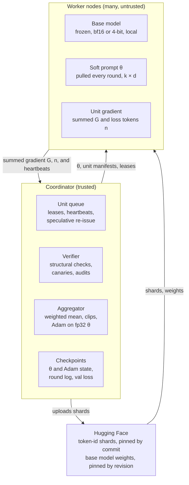
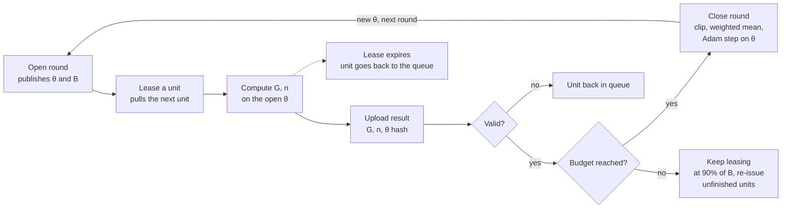

# Distributed Soft Prompt SFT — Design Doc

Oct 18, 2026

Workers return summed gradients on small, deterministic units; the coordinator closes each round on a loss-token budget, so slow nodes just contribute less.

## Goals and non-goals

The system trains one soft prompt on a frozen base model using volunteer GPUs over the public internet, and keeps training when nodes are slow or disappear.

**Goals**

- A round's aggregated gradient equals the gradient of one large batch over the same samples.
- Slow or dropped nodes never stall a round; they only contribute less.
- Wrong, stale or malicious gradients are detected cheaply.
- Any run can be reproduced from the round log.

**Non-goals**

- Data secrecy: the training data is public on Hugging Face, so workers may read it.
- Full fine-tuning of base weights. LoRA adapters fit the same protocol; see the open questions.
- Model-parallel training: every worker holds the full base model locally.
- DPO and RL: version 1 is SFT only.

**Assumptions:** the coordinator is trusted; workers are not. Each worker runs the base model in bf16 or 4-bit locally.

## Architecture



Workers pull manifests and θ from the coordinator and push summed gradients back. Only the coordinator changes θ; Hugging Face serves shards and base weights, so the coordinator carries no bulk traffic.

## Work units and data

A work unit is a small, immutable slice of pre-tokenized data, so any node can recompute any unit and obtain the same gradient.

- The coordinator applies the chat template, tokenizes and builds loss masks once, offline. Workers never tokenize.
- Token-id shards live in a Hugging Face dataset repo and are pinned by commit hash, never by branch name.
- A unit is a row range inside one shard. Its manifest entry holds the shard, the rows, the total tokens and the loss tokens.
- Unit size follows total tokens (about 8k to 32k), so the slowest admitted node finishes in 10 to 30 seconds.
- Rows inside a unit are bucketed by length to cut padding. Sequence packing is not used.
- Workers download a shard once, cache it, check its content hash, and prefetch the next unit while computing.

Total tokens set the compute cost of a unit. Loss tokens (response tokens that carry a label) set its aggregation weight and the round budget.

## Round lifecycle



A round is open while valid loss tokens accumulate toward the budget B. If the hard timeout hits first, the round still closes once it holds at least 70% of B. When it closes, the coordinator clips, aggregates and steps Adam, and the next round opens on the new θ.

## Worker computation

Workers send summed gradients, not averages, so that any set of units adds up exactly to one large batch.

- **Loss:** cross-entropy over labeled tokens with `reduction="sum"`. Micro-batch gradients accumulate without rescaling. The worker reports the summed gradient `G` and the loss-token count `n`.
- **Input:** `inputs_embeds = concat(θ, embed(input_ids))` with θ of shape [k, d]. The attention mask gets k leading ones, labels get k leading `-100`, and position ids follow the extended sequence.
- **Determinism:** dropout is off and the base model runs in eval mode. The same θ and the same unit then give near-identical gradients, which canaries and spot-checks depend on.
- **Precision:** forward and backward in bf16 (or a 4-bit base). θ gradients accumulate in fp32. The coordinator keeps the fp32 master copy of θ and the Adam state.
- **Memory:** gradient checkpointing is on. Workers hold no optimizer state.
- **Early abort:** the heartbeat reply carries the current θ version. If it changes mid-unit, the worker drops the unit instead of finishing a stale gradient.

The worker code is shipped by the coordinator and pinned by hash. The input construction above is the part most likely to drift between independent implementations, so nodes do not write their own.

## Stragglers, failures and stale gradients

Rounds close on a loss-token budget, not on any one node, so a slow node only lowers its own share of the round.

| Situation | Mechanism | Action |
| --- | --- | --- |
| Slow node | Pull queue of small units | A node takes a new unit only when it finishes one, so throughput sets its share. |
| Node disappears | Lease plus heartbeat | The lease expires (about 3× the node's average unit time) or the heartbeat stops; the unit is re-issued. |
| Last units outstanding | Speculative re-issue | At 90% of the budget, unfinished units are duplicated to idle fast nodes. The first valid result wins. |
| Round cannot fill | Hard timeout | Close with at least 70% of the budget and the minimum unit count. |
| Gradient from an old θ | θ hash check | Discard by default. If discards exceed 20 to 30%, accept a lag of one version at weight 0.5. Never accept a lag of two or more. |
| Duplicate result | `unit_id` dedup | Keep the first valid result, drop the rest. |
| Persistently slow node | Throughput EMA | Issue fewer new units; stop issuing below one fifth of the median throughput. |

Discarded and expired units return to the back of the queue and are marked unconsumed, so every sample is eventually used. Speculative copies still running at round close are dropped; units are small, so the waste is small. Any decay weight is applied before gradient clipping.

## Verification and robustness

Every result is checked structurally, and a fraction is checked numerically against the coordinator's own computation.

- **Admission test:** a joining node computes one fixed unit. Its gradient must reach cosine similarity of at least 0.99 with the coordinator's reference. This catches mismatched base weights, quantization or input construction before round one.
- **Structural checks on every result:** shape, finite values, θ hash, valid unexpired lease, `unit_id` not already counted, gradient norm under a cap.
- **Canary units:** 5 to 10% of the queue are units whose reference gradient the coordinator already holds. Workers cannot tell them apart. A mismatch lowers the node's trust score.
- **Audit units:** random units are recomputed on a second node (or on the coordinator) and compared by cosine similarity, with a tolerance for hardware differences.
- **Trust score:** driven by canary and audit outcomes. Low-trust nodes get a higher audit rate, then are removed.
- **Robust aggregation:** each unit's mean gradient is clipped to 3× the round's median norm. A trimmed mean replaces the weighted mean when trust is low. A global norm clip of 1.0 applies before the optimizer step.
- **Rollback:** the coordinator computes validation loss on a fixed held-out set every N rounds. Worker-reported loss is never used for this decision. The best checkpoint is kept, and K consecutive regressions revert to it.
- **Records:** θ plus Adam state is about 5 MB, saved every round. An append-only JSONL log records which unit entered which θ version, which is enough to reproduce a run or trace a bad batch.

## Message schemas

Three messages carry a round: the round descriptor, a unit lease and a result upload.

**Round descriptor** (`GET /round`)

```json
{
  "round_id": 412,
  "theta_version": 411,
  "theta_hash": "sha256:…",
  "theta_url": "…/theta_411.bin",
  "base": {"repo": "…", "revision": "<commit>", "weights_sha256": "…", "dtype": "bf16", "quant": "nf4"},
  "k": 100,
  "max_len": 2048,
  "target_loss_tokens": 300000,
  "min_units": 8,
  "hard_timeout_s": 600
}
```

**Unit lease** (`POST /lease`, response)

```json
{
  "unit_id": "e3-u000123",
  "lease_id": "…",
  "lease_expires": "…",
  "data": {"repo": "me/sft-tokenized", "revision": "<commit>", "shard": "train-00012.parquet", "rows": [1000, 1064]},
  "total_tokens": 24576
}
```

**Result upload** (`POST /result`, gradient attached as binary)

```json
{
  "unit_id": "e3-u000123",
  "lease_id": "…",
  "round_id": 412,
  "theta_hash": "sha256:…",
  "loss_tokens": 11873,
  "loss_sum": 20431.7,
  "grad_dtype": "fp32",
  "grad_sha256": "…",
  "worker_id": "…",
  "sig": "…"
}
```

- The gradient is an fp32 binary of shape [k, d]: about 1.6 MB for k = 100 and d = 4096.
- No field says whether a unit is real, a canary or an audit. That state exists only inside the coordinator.
- A unit moves through `pending`, `leased`, then `done` or `expired`.
- A heartbeat is a periodic `POST` carrying `worker_id` and `lease_id`. Its reply carries the current θ version.

## Coordinator logic

The coordinator closes a round once enough valid loss tokens have arrived, then aggregates, clips and applies one Adam step.

```python
def ready(r):
    full = r.sum_n >= r.target
    late = r.timed_out and r.sum_n >= 0.7 * r.target
    return (full or late) and len(r.valid_units) >= r.min_units

def close_round(r):
    g = [u.grad / u.n for u in r.valid_units]               # per-unit mean gradient
    c = 3 * median(norm(x) for x in g)                      # clip relative to the round median
    g = [x * min(1, c / norm(x)) for x in g]
    agg = weighted_mean(g, [u.n for u in r.valid_units])    # trimmed mean when trust is low
    agg = clip_global_norm(agg, 1.0)
    theta, opt = adam_step(theta, agg, opt)
    save_checkpoint(theta, opt, round_log)
    if r.id % N == 0:
        evaluate_and_maybe_rollback()                       # held-out loss, computed by the coordinator
    open_next_round()
```

- A unit is valid when it passes the structural checks and its θ hash matches the open round. Invalid units return to the queue.
- Weights are loss-token counts `n`, so the effective batch size stays constant from round to round.
- Order of operations: stale weight, per-unit clip, weighted mean, global clip, Adam step.
- The optimizer runs only on the coordinator. Workers never see Adam state.

## Default parameters

These are starting points to tune on a single machine before going distributed, not tested settings.

| Parameter | Starting value | Notes |
| --- | --- | --- |
| Soft prompt length k | 20 to 100 | Initialize by sampling vocabulary embeddings, not random noise. |
| Unit size | 8k to 32k total tokens | Slowest admitted node should finish in 10 to 30 s. |
| Round budget B | 1/100 to 1/50 of the dataset's loss tokens | Gives tens to about 100 rounds per epoch. Example descriptor uses 300,000. |
| Minimum units per round | 8 | Needed for median clipping and trimmed means. |
| Hard round timeout | 600 s | Close at 70% of B or more, with the minimum unit count. |
| Lease length | 3× the node's average unit time | Re-issued on expiry or missed heartbeat. |
| Speculative re-issue | At 90% of B | Duplicate unfinished units to idle fast nodes. |
| Canary and audit share | 5 to 10% of units | Raise for low-trust nodes. |
| Admission cosine threshold | 0.99 | Covers bf16 and quantization noise. |
| Per-unit clip | 3× round median norm | Applied after any stale weight. |
| Global gradient clip | 1.0 | Applied before the Adam step. |
| Optimizer | Adam, warmup then cosine decay | Runs on the coordinator in fp32. |
| Learning rate | 1e-3 to 3e-2 | Much higher than full fine-tuning; sweep it single-machine first. |
| Validation interval N, rollback streak K | Tune | Set from the observed noise in held-out loss. |

## Rollout plan

Four steps, each gating the next, so a failure is traced to one cause.

1. **Single-machine baseline.** Run the worker code on one GPU with a plain optimizer loop. Confirm the soft prompt learns, and sweep learning rate, k and initialization.
2. **Equivalence test.** Split the same data into units across several workers. With clipping off, the summed gradient divided by the summed loss tokens must match the single-machine large-batch gradient within tolerance. If it does not, nothing later can be trusted.
3. **Local simulation.** Run many processes with injected delays, dropouts and fake gradients. Check leases, speculative re-issue, stale handling, canaries and rollback behave as designed.
4. **Live network.** Start with a few trusted nodes through the admission test. Widen participation once canary pass rates and round times are stable.

## Risks and open questions

The main risks are subtle gradient poisoning and a soft prompt that is too small or too sensitive for the task.

**Risks**

- **Subtle poisoning:** canaries catch gross errors, not a small coordinated bias. Trimmed means, audits and validation rollback are the defense.
- **Noisy audits:** hardware differences make gradients non-identical. A tolerance that is too tight accuses honest nodes; too loose misses cheaters.
- **Sensitivity:** high learning rates and initialization can derail a run. Recovery depends on how often validation runs.
- **Capacity:** a soft prompt adjusts style and format well but cannot add much new knowledge. LoRA is the fallback.
- **Single coordinator:** it is trusted and a single point of failure. Per-round checkpoints and the round log allow a restart.
- **Hugging Face limits:** many nodes pulling shards may hit rate limits. Shard caching helps; a mirror is the backstop.

**Open questions**

- [ ] Which base model and quantization? This sets worker memory, k and unit size.
- [ ] Which Hugging Face dataset and mix?
- [ ] Validation interval N and rollback streak K?
- [ ] A known group of participants, or open to strangers? This sets how much auditing and trimming is needed.
- [ ] Move to LoRA later? Workers send gradients, so A and B are never averaged and the protocol is unchanged. What grows is payload size: roughly 33 MB per gradient and per θ download for rank 16 on q and v of a 7B model (my estimate), versus 1.6 MB for the soft prompt.
